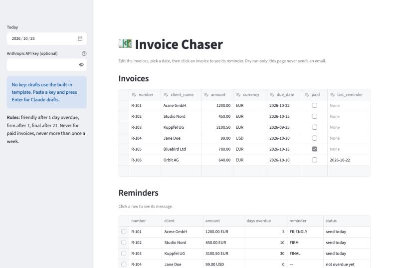
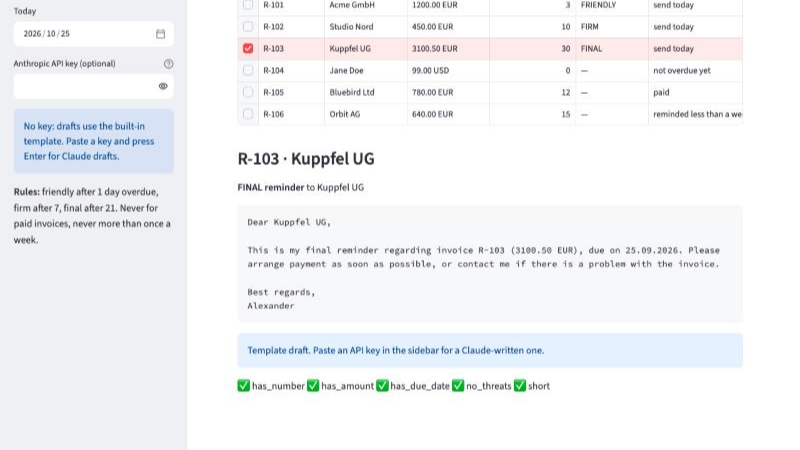

# invoice-chaser

Polite, escalating payment reminders for freelancers. Overdue invoices from a CSV get a
**friendly → firm → final** email, drafted by an LLM (Claude) and checked by an automated eval.
Without an API key it falls back to a deterministic template, so everything runs offline.

## Preview

The local web demo: edit invoices, pick a date and see which reminder each invoice gets.



Click an invoice to read its reminder and the guardrail checks it passed:



## Run it locally (step by step)

You need **Python 3.10+** and **git**. Everything runs on your own machine; the demo never sends an email.

1. Get the code:
   ```bash
   git clone https://github.com/ExNNeph/invoice-chaser.git
   cd invoice-chaser
   ```
2. Create and activate a virtual environment, so nothing is installed system-wide:
   ```bash
   python3 -m venv .venv
   source .venv/bin/activate          # Windows: .venv\Scripts\activate
   ```
3. Install the project with the demo extras:
   ```bash
   pip install -e ".[demo]"
   ```
4. Start the demo:
   ```bash
   invoice-chaser demo
   ```
   Your browser opens **http://localhost:8501**. If it does not, open that address yourself.
5. Stop it with `Ctrl-C` in the terminal. Next time, only steps 2 (`source .venv/bin/activate`) and 4 are needed.

Things to try in the demo:
- **Click a row** in the Reminders table to see that invoice's message and its five checks.
- Move **Today** in the sidebar forward: reminders escalate from friendly to firm to final.
- Tick **paid** on an invoice, or set a recent **last_reminder**: it gets no reminder.
- **Add a row** at the bottom of the invoice table: it gets the next number (e.g. `R-107`) and editable defaults.
- Paste your Anthropic key in the sidebar and **press Enter** (used for this session only, never stored).
  The clicked invoice is then written by Claude; each draft is cached, so clicking around costs nothing extra,
  and "Write a new version" asks for a fresh one. If the call fails, the page shows the exact error;
  if a draft fails a check, the guardrail swaps in the template and says which check failed.

## How it works

1. `schedule.py` – pure function: given an invoice and today's date, which stage (if any) is due.
   Never chases paid invoices, never nags more than once a week.
2. `drafter.py` – LLM drafts the email for that stage; token usage is logged. Every LLM draft must pass
   the rule checks in `checks.py` (amount, number, due date, no threats) before it is used; on a failed
   check or an API error the deterministic template is sent instead.
3. `cli.py` – dry run by default (prints drafts), `--send` sends via SMTP.

## Command line (real use)

With the virtual environment from the steps above active:

```bash
pip install -e ".[dev]"                    # adds pytest
cp invoices.example.csv invoices.csv       # your invoices; columns: see the example file
invoice-chaser invoices.csv                # dry run: prints the drafts, sends nothing
invoice-chaser invoices.csv --send         # sends and records last_reminder
invoice-chaser paid invoices.csv R-001     # stop chasing an invoice
pytest                                     # unit tests + draft-quality eval
```

Environment variables (CLI):

| Variable | Needed for |
|---|---|
| `ANTHROPIC_API_KEY` | LLM drafts (optional; without it the template is used) |
| `INVOICE_CHASER_MODEL` | override the model (default `claude-sonnet-5-5`) |
| `SMTP_HOST`, `SMTP_USER`, `SMTP_PASSWORD` | `--send` (SSL on port 465, e.g. `smtp.gmx.net`; use an app password) |

Example dry-run output:

```
--- R-2026-001 -> bill@acme.de [friendly]
Hi Acme GmbH,

Just a friendly reminder about invoice R-2026-001 (1200.00 EUR), due on 10.01.2026. It has probably
just slipped through. Could you let me know when I can expect the transfer?

Best regards,
Alexander
```

Run it daily with cron (`0 9 * * *  cd /path/to/invoice-chaser && .venv/bin/invoice-chaser invoices.csv --send`);
the one-week gap and `last_reminder` make repeated runs safe.

## Evals

`evals/` holds labeled invoice cases and automatic checks on every draft: invoice number, exact
amount and due date present; no legal threats or invented fees; under 150 words. The same checks
run on the template baseline and on LLM drafts, so a prompt or model change can be compared
numerically instead of by eyeballing.

## Results

`python evals/run_eval.py 3` (4 cases x 3 runs, raw LLM output without the fallback, `claude-sonnet-5-5`):

| prompt version | drafts | all checks pass | has_due_date | other checks |
|---|---|---|---|---|
| v1 (no date format given) | 12 | 75% | 75% | 100% |
| v2 (`Write the due date exactly as DD.MM.YYYY`) | 12 | **100%** | 100% | 100% |
| template baseline | 4 | 100% | 100% | 100% |

The v1 failures were all the due-date check, a prompt gap rather than a model error. With the guardrail
those drafts would have been replaced by the template, so nothing wrong would have been sent.
Cost is about 180 input and 160 output tokens per draft.

End-to-end check: one overdue test invoice sent through GMX SMTP (SSL, port 465) with an LLM draft;
`last_reminder` was written back and a second run the same day sent nothing.

## Known limits

- The eval is small (12 LLM drafts) and rule-based: it checks facts and forbidden phrases, not tone.
  An LLM-as-judge for tone is the next step.
- State is a single CSV, no database, one sender. Fine for a freelancer, not for multi-user use.
- Emails are English only; German drafts are planned.
- Reminder timing (1 / 7 / 21 days overdue, one week gap) is fixed in `schedule.py`.

## License

MIT
